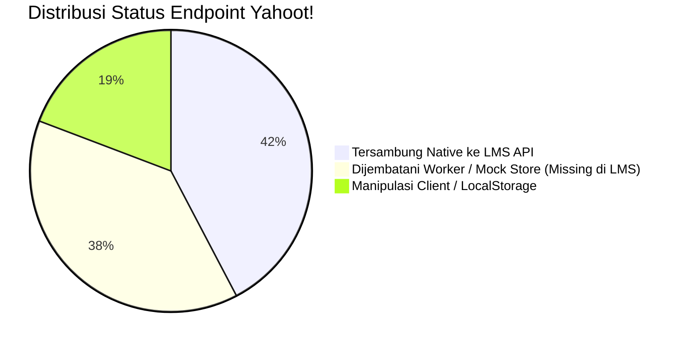
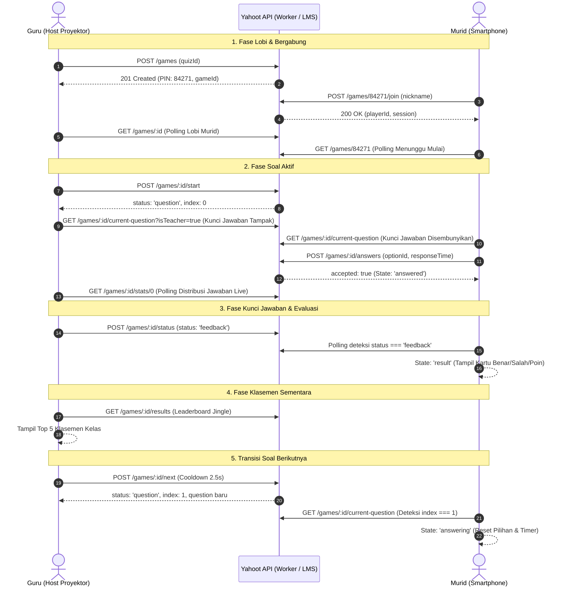

# Yahoot! — Peta Penggunaan Endpoint & Matriks Integrasi API

**Nomor Dokumen**: 05-ENDPOINT-USAGE-MAP  
**Tanggal**: 4 November 2026  
**Status**: Dokumen Arsitektur & Kontrak Integrasi (SOT Pelengkap)  
**Tujuan**: Memetakan setiap interaksi/aksi pengguna (Guru & Murid) ke endpoint API yang digunakan, mengidentifikasi endpoint yang sudah terhubung asli ke LMS backend, yang masih dijembatani Cloudflare Worker/JSON storage, serta variabel/key yang masih dimanipulasi di sisi frontend.

---

## 1. Matriks Ringkasan Eksekutif



| Domain Modul | Total Aksi | Native LMS API (`dev.katib.cloud`) | Cloudflare Worker / Mock | Frontend Manipulated / Client Storage |
|---|:---:|:---:|:---:|:---:|
| **1. Katalog & CRUD Kuis (Guru)** | 7 | 7 (100%) | 0 | 0 |
| **2. Kelola Butir Soal (Guru)** | 5 | 5 (100%) | 0 | 2 (`timeLimit`, `points`) |
| **3. Sesi Live Game & Lobi (Guru)** | 5 | 0 (0%) | 5 (100%) | 2 (`PIN`, `Demo Player`) |
| **4. Kontrol Live Gameplay (Guru)** | 5 | 0 (0%) | 5 (100%) | 1 (`Auto-Transition Guard`) |
| **5. Join & Interaksi Murid (Murid)** | 7 | 1 (14%) | 6 (86%) | 3 (`sessionStorage`, `streak`, `score`) |
| **6. Latihan Mandiri / Solo Play** | 2 | 2 (100%) | 0 | 1 (`solo player session`) |

---

## 2. Peta Alur Aksi Guru (Teacher Flow)

### 2.1. Manajemen Kuis & Kursus

| No | Aksi Pengguna / UI Action | Halaman / Komponen | Endpoint Dipanggil | Method | Status Backend LMS | Catatan & Key yang Dimanipulasi Frontend |
|---|---|---|---|:---:|:---:|---|
| 1 | Membuka Dashboard Guru & melihat daftar kuis | `TeacherDashboardPage.jsx` | `/table/yahoot_quiz/:owner_id/:page` | `GET` | **Tersambung Native** | Mengabaikan record dummy internal `__YAHOOT_ACTIVE_GAMES__`. Menghitung agregat total soal via `reduce()`. |
| 2 | Membuka Tabel Daftar Kuis lengkap | `TeacherQuizListPage.jsx` | `/table/yahoot_quiz/:owner_id/:page?search=` | `GET` | **Tersambung Native** | Filter pencarian judul dan pagination terhubung ke SQL backend. |
| 3 | Membuka form buat kuis baru (Load daftar kursus) | `TeacherQuizCreatePage.jsx` | `/table/courses/:owner_id/1` | `GET` | **Tersambung Native** | Digunakan untuk dropdown kursus pada Mode PILIH. |
| 4 | Memilih kursus (Load section kurikulum) | `TeacherQuizCreatePage.jsx` | `/detail/course_curriculum/:course_id` | `GET` | **Tersambung Native** | Mengisi dropdown bab materi (`section_id`). |
| 5 | Submit kuis baru (Mode PILIH / KETIK / BEBAS) | `TeacherQuizCreatePage.jsx` | `/add/yahoot_quiz` *(alias: `/add/course_quiz`)* | `POST` | **Tersambung Native** | Frontend mengirim `course_id: null` jika Mode KETIK/BEBAS, dan `course_title` manual jika KETIK. |
| 6 | Membuka editor kuis & detail soal | `TeacherQuizEditPage.jsx` | `/detail/yahoot_quiz/:quiz_id` | `GET` | **Tersambung Native** | Mengambil objek kuis dan array pertanyaan. |
| 7 | Mengubah metadata kuis (Judul, Passing Score, dsb.) | `TeacherQuizEditPage.jsx` | `/update/yahoot_quiz/:quiz_id` | `PUT` | **Tersambung Native** | Mengirim field standar LMS (`title`, `passing_score`, `time_limit`). |
| 8 | Mengubah status Publish / Draft | `TeacherQuizEditPage.jsx` | `/update/course_quiz/status/:quiz_id` | `PUT` | **Tersambung Native** | Toggle instan `publish` $\leftrightarrow$ `draft`. |
| 9 | Menghapus kuis | `TeacherQuizListPage.jsx` | `/delete/course_quiz/:quiz_id` | `DELETE` | **Tersambung Native** | Menghapus kuis beserta relasi soal di LMS. |

---

### 2.2. Manajemen Butir Soal Kuis

| No | Aksi Pengguna / UI Action | Halaman / Komponen | Endpoint Dipanggil | Method | Status Backend LMS | Catatan & Key yang Dimanipulasi Frontend |
|---|---|---|---|:---:|:---:|---|
| 10 | Menambah 1 butir soal (Pilihan Ganda / True-False / Isian) | `TeacherQuizEditPage.jsx` $\rightarrow$ `QuizEditor.jsx` | `/add/course_quiz_question` | `POST` | **Tersambung Native** | **Manipulasi Frontend:** Backend hanya punya `option_a..d`. Frontend menyimpan `timeLimit` & `points` ke `localStorage ('yahoot_q_timelimit_<id>')`. |
| 11 | Mengubah butir soal | `TeacherQuizEditPage.jsx` $\rightarrow$ `QuizEditor.jsx` | `/update/course_quiz_question/:question_id` | `PUT` | **Tersambung Native** | Transformasi tipe soal `true_false` diubah ke opsi A (`True`) dan B (`False`). |
| 12 | Menghapus butir soal | `TeacherQuizEditPage.jsx` | `/delete/course_quiz_question/:question_id` | `DELETE` | **Tersambung Native** | Menghapus baris soal dari database. |
| 13 | Impor banyak soal sekaligus (Bulk JSON Import) | `TeacherQuizEditPage.jsx` (Modal Impor) | `/import/course_quiz_questions` | `POST` | **Tersambung Native** | Frontend mem-parsing JSON, memvalidasi array butir soal, dan mengirim array atomik ke backend. |
| 14 | Preview simulasi soal di modal | `TeacherQuizEditPage.jsx` | *None (Client Side)* | `-` | **Client Only** | Me-render kartu pertanyaan dan opsi jawaban tanpa memanggil backend. |

---

### 2.3. Sesi Permainan Langsung (Live Game Host)

| No | Aksi Pengguna / UI Action | Halaman / Komponen | Endpoint Dipanggil | Method | Status Backend LMS | Catatan & Key yang Dimanipulasi Frontend |
|---|---|---|---|:---:|:---:|---|
| 15 | Menekan tombol "Host Kuis / Mainkan" | Dashboard / Quiz Edit Page | `/games` | `POST` | **Belum Ada di LMS API** *(Worker / Mock)* | Backend LMS belum punya generator PIN. Dibuat via `worker.js` (PIN 5-digit acak). Data kuis disimpan sementara di record #9 Katib. |
| 16 | Membuka layar Lobi Game & Polling Murid Bergabung | `TeacherGameLobbyPage.jsx` | `/games/:gameId` | `GET` | **Belum Ada di LMS API** *(Worker / Mock)* | Frontend me-render QR Code dari URL `origin + /join?pin=<code>` via library `qrcode`. Polling per 1000ms. |
| 17 | Menambah murid demo (Simulasi guru) | `TeacherGameLobbyPage.jsx` | `/games/:gameId/demo-player` | `POST` | **Belum Ada di LMS API** *(Worker / Mock)* | Menambahkan objek murid acak ke array `players` di memory worker / mockStore. |
| 18 | Memulai Game ("Mulai Kuis") | `TeacherGameLobbyPage.jsx` | `/games/:gameId/start` | `POST` | **Belum Ada di LMS API** *(Worker / Mock)* | Mengubah `status` game dari `'lobby'` menjadi `'question'`, index disetel ke `0`, mencatat `questionStartedAt = Date.now()`. |
| 19 | Polling State Soal Aktif & Statistik Jawaban | `TeacherGamePlayPage.jsx` | `/games/:gameId/current-question?isTeacher=true` & `/games/:gameId/stats/:qIndex` | `GET` | **Belum Ada di LMS API** *(Worker / Mock)* | Polling per 1500ms. Mengambil soal aktif dan distribusi jumlah jawaban pemilih opsi A, B, C, D. |
| 20 | Auto-Transition ke Kunci Jawaban saat semua murid menjawab | `TeacherGamePlayPage.jsx` | `/games/:gameId/status` (`status: 'feedback'`) | `POST` | **Belum Ada di LMS API** *(Worker / Mock)* | **Manipulasi Frontend:** Dijaga oleh `justAdvancedRef` (cooldown 2.5s) dan syarat `totalAnswers > 0 && totalAnswers >= totalPlayers && qIndex === currentIndex`. |
| 21 | Guru menekan tombol "Kunci Jawaban" secara manual | `TeacherGamePlayPage.jsx` | `/games/:gameId/status` (`status: 'feedback'`) | `POST` | **Belum Ada di LMS API** *(Worker / Mock)* | Menghentikan audio SpongeBob, menyalakan audio Fanfare, dan memberi instruksi murid untuk menampilkan hasil evaluasi. |
| 22 | Guru membuka "Klasemen Sementara" | `TeacherGamePlayPage.jsx` | `/games/:gameId/results` | `GET` | **Belum Ada di LMS API** *(Worker / Mock)* | Menghentikan audio Fanfare, memutar audio Drumroll Klasemen, me-render Top 5 / Full klasemen nilai murid. |
| 23 | Guru menekan "Soal Berikutnya" | `TeacherGamePlayPage.jsx` | `/games/:gameId/next` | `POST` | **Belum Ada di LMS API** *(Worker / Mock)* | Meng-increment `currentQuestionIndex`, me-reset `answers[index] = {}`, status kembali ke `'question'`. Memutar ulang musik SpongeBob. |
| 24 | Game selesai $\rightarrow$ Menampilkan Podium Juara | `TeacherGameResultPage.jsx` | `/games/:gameId/results` | `GET` | **Belum Ada di LMS API** *(Worker / Mock)* | Mengambil daftar peringkat murid terurut nilai tertinggi untuk animasi podium 3D Juara 1, 2, 3. |

---

## 3. Peta Alur Aksi Murid (Student Flow)

| No | Aksi Murid / UI Action | Halaman / Komponen | Endpoint Dipanggil | Method | Status Backend LMS | Catatan & Key yang Dimanipulasi Frontend |
|---|---|---|---|:---:|:---:|---|
| 25 | Murid memasukkan 5 digit PIN kuis | `JoinPage.jsx` | `/games/:code` | `GET` | **Belum Ada di LMS API** *(Worker / Mock)* | Validasi keberadaan ruangan game sebelum memasukkan nickname. |
| 26 | Murid memindai QR Code proyektor via kamera HP | `JoinPage.jsx` (Modal Scanner) | `/games/:code` | `GET` | **Belum Ada di LMS API** *(Worker / Mock)* | Diproses di frontend via `html5-qrcode`. URL hasil scan diekstrak parameter `?pin=12345` lalu divalidasi. |
| 27 | Murid memasukkan Nickname & Bergabung | `JoinPage.jsx` | `/games/:code/join` | `POST` | **Belum Ada di LMS API** *(Worker / Mock)* | **Manipulasi Frontend:** Menyimpan payload sesi `{ playerId, nickname, gameCode, gameId }` ke `sessionStorage ('yahoot_player')`. |
| 28 | Murid menunggu di Lobi Game | `StudentLobbyPage.jsx` | `/games/:code` | `GET` | **Belum Ada di LMS API** *(Worker / Mock)* | Polling per 1000ms. Otomatis redirect ke `/game/:code/play` jika `game.status === 'question'`. |
| 29 | Murid menerima soal & memulai timer countdown | `StudentPlayPage.jsx` | `/games/:gameId/current-question` | `GET` | **Belum Ada di LMS API** *(Worker / Mock)* | **Aturan Keamanan:** Endpoint tidak menyertakan `correctOptionId`. Timer dimount ulang per butir soal via `key="q_index_id"`. |
| 30 | Murid memilih opsi jawaban (Pilihan Ganda / True-False) | `StudentPlayPage.jsx` $\rightarrow$ `QuestionOption.jsx` | `/games/:gameId/answers` | `POST` | **Belum Ada di LMS API** *(Worker / Mock)* | Mengirim `{ playerId, questionId, optionId, responseTimeSeconds }`. Menghitung skor kecepatan dan streak murid. |
| 31 | Murid mengetik isian singkat (Short Answer) | `StudentPlayPage.jsx` | `/games/:gameId/answers` | `POST` | **Belum Ada di LMS API** *(Worker / Mock)* | Mengirim string jawaban teks. Backend worker mencocokkan case-insensitive. |
| 32 | Menunggu evaluasi (Layar "Jawaban Terkirim") | `StudentPlayPage.jsx` | *None (Polling current-question)* | `GET` | **Belum Ada di LMS API** *(Worker / Mock)* | Murid melihat opsi pilihannya sendiri dan menunggu guru membuka kunci jawaban (`gameStatus === 'feedback'`). |
| 33 | Waktu habis sebelum menjawab | `StudentPlayPage.jsx` $\rightarrow$ `Timer.jsx` | *Client Timer Event* | `-` | **Client Only** | `onTimeUp` memindahkan state ke `time-expired`. Murid mendapat 0 poin. |
| 34 | Layar Hasil Kunci Jawaban terbuka | `StudentPlayPage.jsx` | `/games/:gameId/results` | `GET` | **Belum Ada di LMS API** *(Worker / Mock)* | Menampilkan status kartu: "JAWABAN BENAR (+pts)", "JAWABAN KURANG TEPAT", atau "BELUM SEMPAT MENJAWAB ⏱️" (jika murid tidak submit). |
| 35 | Melihat skor dan peringkat akhir pribadi | `StudentResultPage.jsx` | `/games/:gameId/results` | `GET` | **Belum Ada di LMS API** *(Worker / Mock)* | Menampilkan medali pribadi (Juara 1, 2, 3, atau Peringkat #N) dan kartu rincian skor akhir. |
| 36 | Membuka katalog kuis mandiri (Solo Mode) | `StudentQuizListPage.jsx` | `/list/yahoot_quiz/:customer_id` | `GET` | **Tersambung Native** | Mengambil kuis umum publik LMS yang dapat dikerjakan siswa secara mandiri. |
| 37 | Memulai pengerjaan kuis solo mandiri | `StudentQuizListPage.jsx` | `/games` & Auto-Join | `POST` | **Belum Ada di LMS API** *(Worker / Mock)* | Otomatis membuat sesi solo sementara dan mendaftarkan pemain `Murid XXX` ke `sessionStorage`. |

---

## 4. Matriks Detail Variabel & Key yang Dimanipulasi Frontend

Tabel berikut merangkum seluruh variabel data yang tidak tersedia pada skema tabel MySQL LMS saat ini, serta bagaimana frontend mengompensasinya:

| Variabel / Key | Lokasi Komponen Frontend | Mekanisme Manipulasi Saat Ini | Kebutuhan Kolom Database LMS |
|---|---|---|---|
| `timeLimit` (durasi soal, detik) | `QuizEditor.jsx`, `TeacherQuizEditPage.jsx`, `QuestionCard.jsx` | Disimpan terpisah di `localStorage ('yahoot_q_timelimit_<qId>')`. Fallback ke 20 detik jika null. | Kolom `time_limit INT UNSIGNED DEFAULT 20` pada tabel `course_quiz_questions`. |
| `points` (bobot nilai butir soal) | `QuizEditor.jsx`, `TeacherQuizEditPage.jsx`, `ScoreCard.jsx` | Disimpan terpisah di `localStorage ('yahoot_q_points_<qId>')`. Fallback ke 100 poin jika null. | Kolom `points INT UNSIGNED DEFAULT 100` pada tabel `course_quiz_questions`. |
| `question_type` | `quizzes.js`, `QuestionOption.jsx`, `QuizEditor.jsx` | Di-derive secara *runtime*: jika A/B kosong $\rightarrow$ `short_answer`; jika teks "True/False" $\rightarrow$ `true_false`; lainnya $\rightarrow$ `multiple_choice`. | Kolom `question_type ENUM('multiple_choice', 'true_false', 'short_answer')` pada tabel `course_quiz_questions`. |
| `pin_code` (PIN 5 digit) | `TeacherGameLobbyPage.jsx`, `JoinPage.jsx`, `worker.js` | Digenerate oleh fungsi matematika acak `Math.floor(10000 + Math.random() * 90000)` di worker. | Kolom `pin_code VARCHAR(10) UNIQUE` pada tabel `yahoot_game_sessions`. |
| `playerId` & Session Murid | `JoinPage.jsx`, `StudentPlayPage.jsx` | Digenerate acak `player_<timestamp>_<rand>` dan disimpan di browser `sessionStorage ('yahoot_player')`. | Tabel `yahoot_game_players` (`id`, `game_id`, `nickname`, `score`, `streak`). |
| `streak` (Jawaban Beruntun) | `StudentPlayPage.jsx`, `TeacherGamePlayPage.jsx` | Dihitung manual saat submit: `isCorrect ? streak + 1 : 0`. | Kolom `streak INT DEFAULT 0` pada tabel `yahoot_game_players`. |
| `speedFactor` (Bonus Kecepatan) | `worker.js`, `mockStore.js` | Rumus: $\text{points} \times \max(0.5, 1 - \frac{\text{elapsed}}{2 \times \text{timeLimit}})$. Dihitung di JavaScript worker. | Dihitung di stored procedure / controller backend saat mengeksekusi `POST /answers`. |
| State Sesi Permainan Monolitik | `worker.js` | Seluruh objek game (`players`, `answers`, `status`, `questionIndex`) dikonversi ke JSON string dan disimpan di `course_quiz.description` (Record #9 Katib). | Tabel relasional terpisah: `yahoot_game_sessions`, `yahoot_game_players`, `yahoot_game_answers`. |

---

## 5. Diagram Alur Transisi Endpoint Gameplay Real-Time



---

## 6. Rekomendasi Format Kontrak Endpoint untuk Tim Backend LMS

Agar tim backend `ngodingai-lms-API` dapat langsung mengadopsi modul live game ini tanpa merusak alur frontend yang sudah berjalan, berikut adalah format kontrak JSON yang diharapkan:

### A. Endpoint Pembuatan Ruangan Game: `POST /api/v1/games`
* **Request Body**:
```json
{
  "quizId": 16,
  "ownerId": 4409
}
```
* **Response (201 Created)**:
```json
{
  "data": {
    "id": "game_1730700000_123",
    "code": "84271",
    "status": "lobby",
    "quizTitle": "Kuis Logika Dasar",
    "totalQuestions": 10
  }
}
```

### B. Endpoint Bergabung Murid: `POST /api/v1/games/:code/join`
* **Request Body**:
```json
{
  "nickname": "Rian Pratama"
}
```
* **Response (200 OK)**:
```json
{
  "data": {
    "playerId": "player_1730700100_99",
    "nickname": "Rian Pratama",
    "gameCode": "84271",
    "gameId": "game_1730700000_123"
  }
}
```

### C. Endpoint Soal Aktif Murid: `GET /api/v1/games/:gameId/current-question`
* **Response (200 OK)**:
```json
{
  "data": {
    "id": "q_1",
    "index": 0,
    "totalQuestions": 10,
    "type": "multiple_choice",
    "question": "Apa output dari console.log(typeof NaN)?",
    "options": [
      { "id": "a", "text": "number" },
      { "id": "b", "text": "NaN" },
      { "id": "c", "text": "undefined" },
      { "id": "d", "text": "object" }
    ],
    "timeLimit": 20,
    "points": 100,
    "gameStatus": "question",
    "finished": false
  }
}
```
*(Catatan: Field `correctOptionId` dan `correct_answer` hanya disertakan jika query parameter `?isTeacher=true` dikirim bersama token otentikasi guru).*

### D. Endpoint Pengiriman Jawaban: `POST /api/v1/games/:gameId/answers`
* **Request Body**:
```json
{
  "playerId": "player_1730700100_99",
  "questionId": "q_1",
  "questionIndex": 0,
  "optionId": "a",
  "responseTimeSeconds": 4.2
}
```
* **Response (200 OK)**:
```json
{
  "data": {
    "accepted": true,
    "correct": true,
    "pointsEarned": 895,
    "totalScore": 895,
    "streak": 1
  }
}
```

---
*Dokumen ini merupakan Source of Truth resmi untuk pemetaan endpoint Yahoot! dan dapat digunakan sebagai checklist verifikasi integrasi backend.*
