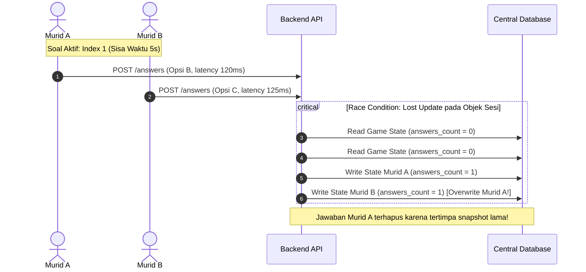

# Laporan Analisis Integrasi API & Audit Race Condition Yahoot! Multiplayer

**Tanggal**: 2 November 2026  
**Target Sistem**: 
1. **Frontend**: Yahoot! Web App (`yahoot-quiz.anditaurban.workers.dev` / `yahoot.test`)  
2. **Backend**: NgodingAI LMS API (`https://dev.katib.cloud` / `C:\laragon\www\ngodingai-lms-API`)  
**Tujuan Dokumen**: Menjadi acuan resmi kesenjangan data (gap analysis), variabel/key yang masih dimanipulasi di frontend, serta audit komprehensif penanganan *race condition* pada modul interaksi langsung murid (*realtime answer submission*) untuk *roadmap* pengembangan backend berikutnya.

---

## DAFTAR ISI
1. [Ringkasan Eksekutif & Arsitektur Saat Ini](#1-ringkasan-eksekutif--arsitektur-saat-ini)
2. [Bagian & Endpoint yang Belum Tersedia di Backend LMS API](#2-bagian--endpoint-yang-belum-tersedia-di-backend-lms-api)
3. [Variabel & Key yang Masih Dimanipulasi / Mengandalkan Frontend](#3-variabel--key-yang-masih-dimanipulasi--mengandalkan-frontend)
4. [Audit Menyeluruh: Race Condition Sisi Backend Terkait Jawaban Murid](#4-audit-menyeluruh-race-condition-sisi-backend-terkait-jawaban-murid)
5. [Usulan Solusi Arsitektur & Skema Database Backend](#5-usulan-solusi-arsitektur--skema-database-backend)
6. [Checklist Prioritas Pengembangan Backend LMS](#6-checklist-prioritas-pengembangan-backend-lms)

---

## 1. Ringkasan Eksekutif & Arsitektur Saat Ini

Saat ini, sistem Yahoot! terbagi menjadi 2 domain integrasi:

1. **Modul Kuis Statis (Sudah Terhubung ke LMS API)**:
   - Manajemen kuis (`/table/yahoot_quiz`, `/detail/yahoot_quiz`, `/add/yahoot_quiz`, `/update/yahoot_quiz`, `/delete/yahoot_quiz`).
   - Manajemen butir soal (`/add/course_quiz_question`, `/import/course_quiz_questions`, `/update/course_quiz_question`).
   - Seluruh modul ini telah terhubung ke database MySQL LMS via REST API.

2. **Modul Live Multiplayer Game (Belum Ada Endpoint Native di LMS API)**:
   - Sesi permainan langsung (*room/PIN game*, lobi murid, penayangan soal real-time, submit jawaban kompetitif, dan klasemen langsung) **belum memiliki endpoint maupun tabel native di `ngodingai-lms-API`**.
   - Untuk sementara waktu, modul ini berjalan menggunakan jembatan *Cloudflare Worker API* (`src/worker.js`) dengan teknik penyimpanan *centralized state* di dalam kolom `description` (JSON string) pada record LMS Quiz #9 atau lokal `mockStore` di browser.

Mekanisme sementara ini memiliki keterbatasan skalabilitas, latensi serialisasi JSON, dan kerentanan *race condition* tinggi saat banyak murid menjawab soal secara bersamaan.

---

## 2. Bagian & Endpoint yang Belum Tersedia di Backend LMS API

Berikut adalah daftar endpoint modul live game yang ada pada SOT [`docs/04-API-SPEC.md`](file:///C:/laragon/www/yahoot!/docs/04-API-SPEC.md) namun **belum diimplementasikan sama sekali** di repositori backend [`ngodingai-lms-API`](file:///C:/laragon/www/ngodingai-lms-API):

| No | Method | Endpoint SOT | Fungsi & Kebutuhan | Status di LMS Backend |
|---|---|---|---|---|
| 1 | `POST` | `/api/v1/games` | Guru membuat ruangan kuis baru berdasarkan `quizId`. Backend mengenerate PIN unik 5-digit dan ID sesi (`game_xxx`). | **Belum Ada** (Ditangani worker / mock) |
| 2 | `GET` | `/api/v1/games/:code` | Mengecek status lobi game via kode PIN dan mengambil daftar murid yang sudah bergabung. | **Belum Ada** (Ditangani worker / mock) |
| 3 | `POST` | `/api/v1/games/:code/join` | Murid bergabung ke lobi menggunakan PIN dan `nickname`. Mengembalikan `playerId` unik. | **Belum Ada** (Ditangani worker / mock) |
| 4 | `POST` | `/api/v1/games/:gameId/start` | Guru memulai permainan, mengubah status game dari `lobby` menjadi `question` pada butir soal pertama. | **Belum Ada** (Ditangani worker / mock) |
| 5 | `GET` | `/api/v1/games/:gameId/current-question` | Mengambil soal aktif saat ini. Wajib memfilter `correctOptionId` agar tidak bocor ke sisi murid. | **Belum Ada** (Ditangani worker / mock) |
| 6 | `POST` | `/api/v1/games/:gameId/answers` | Murid mengirim jawaban ke server beserta `responseTimeSeconds` untuk kalkulasi skor kecepatan. | **Belum Ada** (Ditangani worker / mock) |
| 7 | `POST` | `/api/v1/games/:gameId/next` | Guru memajukan kuis ke butir soal berikutnya atau mengakhiri game (`finished`). | **Belum Ada** (Ditangani worker / mock) |
| 8 | `POST` | `/api/v1/games/:gameId/status` | Mengubah status fase permainan (`question` $\rightarrow$ `feedback` / kunci jawaban $\rightarrow$ `leaderboard`). | **Belum Ada** (Ditangani worker / mock) |
| 9 | `GET` | `/api/v1/games/:gameId/stats/:questionIndex` | Distribusi pilihan jawaban murid secara real-time (jumlah pemilih opsi A, B, C, D) untuk grafik proyektor guru. | **Belum Ada** (Ditangani worker / mock) |
| 10 | `GET` | `/api/v1/games/:gameId/results` | Mengambil klasemen akhir, peringkat akumulasi skor, dan streak murid. | **Belum Ada** (Ditangani worker / mock) |

---

## 3. Variabel & Key yang Masih Dimanipulasi / Mengandalkan Frontend

Karena tabel SQL pada backend LMS (`course_quiz` dan `course_quiz_questions`) awalnya dirancang untuk ujian konvensional statis, ada beberapa variabel penting yang terpaksa dimanipulasi atau disimpan di browser frontend:

### A. Waktu dan Poin per Butir Soal (`timeLimit` & `points`)
- **Kondisi Backend Saat Ini**: Kolom `time_limit` hanya ada pada tabel kuis (`course_quiz`) dalam satuan menit (untuk durasi total satu ujian). Tabel butir soal `course_quiz_questions` **tidak memiliki kolom `time_limit` dan `points` per soal**.
- **Manipulasi Frontend**:
  - Frontend menyimpan durasi per soal ke `localStorage` dengan key `yahoot_q_timelimit_<question_id>` (default 20 detik).
  - Poin per soal disimpan di `localStorage` dengan key `yahoot_q_points_<question_id>` (default 100 poin).
  - Jika browser ganti perangkat atau membersihkan *cache*, konfigurasi waktu khusus per butir soal kembali ke default.
- **Rekomendasi Backend**: Tambahkan kolom `time_limit` (INT, satuan detik) dan `points` (INT, default 100) pada tabel `course_quiz_questions`.

### B. Format Tipe Soal (`type`)
- **Kondisi Backend Saat Ini**: Backend hanya mengenali kolom `option_a`, `option_b`, `option_c`, `option_d`.
- **Manipulasi Frontend**:
  - Frontend melakukan *inference* otomatis di file [`src/services/api/quizzes.js`](file:///C:/laragon/www/yahoot!/src/services/api/quizzes.js):
    - Jika opsi A & B bernilai `"True"` / `"False"`, disimpulkan sebagai `type: 'true_false'`.
    - Jika opsi A sampai D kosong / null, disimpulkan sebagai `type: 'short_answer'` (isian ketik).
    - Jika opsi A sampai D terisi, disimpulkan sebagai `type: 'multiple_choice'`.
- **Rekomendasi Backend**: Tambahkan kolom `question_type` bertipe `ENUM('multiple_choice', 'true_false', 'short_answer')` agar data eksplisit dan konsisten.

### C. Sesi Pemain & Skor (`playerId`, `streak`, `score`)
- **Kondisi Backend Saat Ini**: Tidak ada tabel `game_players` atau `session_players`.
- **Manipulasi Frontend**:
  - Identitas pemain dibuat di frontend menggunakan format `player_<timestamp>_<random>` dan disimpan di `sessionStorage ('yahoot_player')`.
  - Akumulasi *streak* (jawaban benar berturut-turut) dan formula bonus kecepatan (*speed factor*) dihitung secara manual di sisi worker/frontend.
- **Rekomendasi Backend**: Buat tabel relasi pemain sesi live agar skor dan riwayat jawaban terverifikasi secara matematis di server (*authoritative server*).

---

## 4. Audit Menyeluruh: Race Condition Sisi Backend Terkait Jawaban Murid

Saat sebuah sesi kuis Yahoot! dimainkan oleh 20–50 murid secara serentak di kelas, operasi pengiriman jawaban (`POST /answers`) sangat rentan mengalami *race condition* jika backend tidak dirancang dengan isolasi transaksi yang ketat.

Berikut adalah 5 titik kritis *race condition* yang teridentifikasi beserta dampaknya:



### 1. Masalah "Lost Update" pada Penyimpanan Objek/JSON Monolitik
- **Akar Masalah**: Jika backend menyimpan state kuis langsung sebagai satu baris record atau dokumen JSON besar (seperti penyimpanan state sementara saat ini), alur yang terjadi adalah:
  1. Request Murid A membaca `answers = {}`.
  2. Request Murid B membaca `answers = {}`.
  3. Murid A menulis `answers = { playerA: 'b' }`.
  4. Murid B menulis `answers = { playerB: 'c' }`.
- **Dampak**: State jawaban Murid A terhapus (*lost update*) karena tertimpa oleh *write operation* Murid B.
- **Solusi Backend Wajib**: Jawaban setiap murid **wajib disimpan sebagai baris baris tabel tersendiri (Atomic INSERT)**, bukan meng-overwrite kolom JSON kuis secara keseluruhan.

### 2. Auto-Reveal Status Flip Race Condition (Pemicu Error Terakhir)
- **Akar Masalah**: Sistem kompetitif memeriksa:
  $$\text{totalAnswers} \ge \text{totalPlayers} \implies \text{status} = \text{'feedback'}$$
  Jika ada keterlambatan jaringan (*network jitter*) di mana jawaban murid untuk **Soal Sebelumnya** baru tiba di server tepat saat Guru menekan tombol **"Soal Berikutnya"**:
  - Request jawaban lama memicu kalkulasi `totalAnswers >= totalPlayers` pada index lama.
  - Server secara keliru mengubah status sesi global menjadi `'feedback'`.
  - Murid yang baru saja menerima soal baru langsung mendapati status kuis terkunci ke pembahasan, sehingga sistem menganggap murid belum menjawab dan menampilkan peringatan **"Jawaban Kurang Tepat / Belum Sempat Menjawab"**.
- **Solusi Backend Wajib**:
  - Validasi ketat nomor indeks: Jawaban hanya boleh diterima jika `submittedQuestionIndex === session.currentQuestionIndex`.
  - Kunci auto-reveal hanya boleh dievaluasi terhadap indeks soal yang sedang aktif.

### 3. Double Submission & Duplicate Points
- **Akar Masalah**: Di jaringan seluler atau WiFi sekolah yang tidak stabil, murid sering menekan tombol pilihan berkali-kali (*rapid taps*) atau browser melakukan HTTP *auto-retry*.
- **Dampak**: Skor murid bertambah 2x lipat, streak bertambah lebih dari 1, dan statistik grafik jawaban guru menjadi lebih banyak daripada jumlah murid yang hadir.
- **Solusi Backend Wajib**:
  - Tambahkan *Database Unique Constraint*:
    ```sql
    UNIQUE KEY uq_game_question_player (game_id, question_id, player_id)
    ```
  - Jika record sudah ada, query otomatis me-reject dengan error `ALREADY_ANSWERED` (HTTP 409) atau mengembalikan respons idempoten yang sama tanpa menambahkan poin baru.

### 4. Perbedaan Jam Client vs Server (*Clock Skew / Timing Spoofing*)
- **Akar Masalah**: Skor kecepatan dihitung berdasarkan selisih waktu `responseTimeSeconds` yang dikirim dari browser murid.
- **Dampak**: Murid dapat memanipulasi payload HTTP untuk mengirim `responseTimeSeconds = 0.05` detik agar selalu mendapat poin maksimum (1000 poin). Sebaliknya, jika jam HP murid terlambat 5 detik, sisa waktu murid bisa langsung habis sebelum sempat menjawab.
- **Solusi Backend Wajib**:
  - Kalkulasi waktu respons **harus dihitung di server** (*authoritative timing*):
    $$\text{elapsedSeconds} = \frac{\text{NOW}() - \text{game.questionStartedAt}}{1000}$$
  - Abaikan waktu yang dikirim oleh perangkat klien kecuali sebagai pembanding toleransi latensi jaringan (maksimal toleransi 1 detik).

### 5. Transisi Soal Guru vs Murid Terputus (*Split-Brain State*)
- **Akar Masalah**: Jika guru menekan "Soal Berikutnya" saat ada murid yang baru menekan jawaban pada detik terakhir:
  - Transisi status game ke soal baru harus bersifat atomik menggunakan transaksi SQL (`START TRANSACTION ... COMMIT`).
  - Request jawaban yang tiba setelah status berganti harus ditolak secara anggun (*gracefully rejected*) dengan pesan yang jelas, bukan menimbulkan *unhandled error* atau merusak state soal baru.

---

## 5. Usulan Solusi Arsitektur & Skema Database Backend

Untuk mengatasi seluruh kendala di atas secara permanen, tim backend `ngodingai-lms-API` disarankan mengimplementasikan 3 tabel baru di MySQL:

### A. Tabel `yahoot_game_sessions` (Sesi Permainan)
```sql
CREATE TABLE `yahoot_game_sessions` (
  `id` VARCHAR(64) NOT NULL PRIMARY KEY,
  `pin_code` VARCHAR(10) NOT NULL UNIQUE,
  `quiz_id` INT UNSIGNED NOT NULL,
  `owner_id` INT UNSIGNED NOT NULL,
  `status` ENUM('lobby', 'question', 'feedback', 'finished') NOT NULL DEFAULT 'lobby',
  `current_question_index` INT UNSIGNED NOT NULL DEFAULT 0,
  `total_questions` INT UNSIGNED NOT NULL DEFAULT 0,
  `question_started_at` BIGINT UNSIGNED NULL,
  `created_at` DATETIME NOT NULL DEFAULT CURRENT_TIMESTAMP,
  `updated_at` DATETIME NOT NULL DEFAULT CURRENT_TIMESTAMP ON UPDATE CURRENT_TIMESTAMP,
  INDEX `idx_pin_status` (`pin_code`, `status`),
  INDEX `idx_owner` (`owner_id`)
) ENGINE=InnoDB DEFAULT CHARSET=utf8mb4;
```

### B. Tabel `yahoot_game_players` (Daftar Murid dalam Sesi)
```sql
CREATE TABLE `yahoot_game_players` (
  `id` VARCHAR(64) NOT NULL PRIMARY KEY,
  `game_id` VARCHAR(64) NOT NULL,
  `nickname` VARCHAR(50) NOT NULL,
  `score` INT NOT NULL DEFAULT 0,
  `streak` INT NOT NULL DEFAULT 0,
  `joined_at` DATETIME NOT NULL DEFAULT CURRENT_TIMESTAMP,
  UNIQUE KEY `uq_game_nickname` (`game_id`, `nickname`),
  INDEX `idx_game_score` (`game_id`, `score` DESC)
) ENGINE=InnoDB DEFAULT CHARSET=utf8mb4;
```

### C. Tabel `yahoot_game_answers` (Rekaman Jawaban Murid per Soal)
```sql
CREATE TABLE `yahoot_game_answers` (
  `id` BIGINT UNSIGNED AUTO_INCREMENT PRIMARY KEY,
  `game_id` VARCHAR(64) NOT NULL,
  `question_index` INT UNSIGNED NOT NULL,
  `question_id` VARCHAR(64) NOT NULL,
  `player_id` VARCHAR(64) NOT NULL,
  `option_id` VARCHAR(100) NOT NULL,
  `is_correct` TINYINT(1) NOT NULL,
  `points_earned` INT NOT NULL DEFAULT 0,
  `response_time_ms` INT UNSIGNED NOT NULL DEFAULT 0,
  `submitted_at` DATETIME NOT NULL DEFAULT CURRENT_TIMESTAMP,
  UNIQUE KEY `uq_player_per_question` (`game_id`, `question_index`, `player_id`),
  INDEX `idx_stats` (`game_id`, `question_index`, `option_id`)
) ENGINE=InnoDB DEFAULT CHARSET=utf8mb4;
```

### D. Perubahan Tambahan pada Tabel `course_quiz_questions`
Tambahkan kolom pendukung di tabel butir soal yang sudah ada:
```sql
ALTER TABLE `course_quiz_questions`
  ADD COLUMN `question_type` ENUM('multiple_choice', 'true_false', 'short_answer') NOT NULL DEFAULT 'multiple_choice' AFTER `question_text`,
  ADD COLUMN `time_limit` INT UNSIGNED NOT NULL DEFAULT 20 AFTER `correct_answer`,
  ADD COLUMN `points` INT UNSIGNED NOT NULL DEFAULT 100 AFTER `time_limit`;
```

---

## 6. Checklist Prioritas Pengembangan Backend LMS

Berikut adalah urutan prioritas rekomendasi untuk *sprint* backend berikutnya:

- [ ] **Prioritas 1 (Database Migration)**:
  - Tambahkan kolom `time_limit`, `points`, dan `question_type` pada tabel `course_quiz_questions` agar frontend tidak perlu lagi memanipulasi data di `localStorage`.
- [ ] **Prioritas 2 (Tabel Game Session)**:
  - Jalankan skrip pembuatan tabel `yahoot_game_sessions`, `yahoot_game_players`, dan `yahoot_game_answers`.
- [ ] **Prioritas 3 (Endpoint Core Live Game)**:
  - Buat router baru `components/lms/yahoot-game/router.js` di `ngodingai-lms-API`.
  - Implementasikan endpoint `POST /games`, `GET /games/:code`, `POST /games/:code/join`, dan `POST /games/:gameId/start`.
- [ ] **Prioritas 4 (Atomic Answer Submission & Anti-Race Condition)**:
  - Implementasikan `POST /games/:gameId/answers` menggunakan transaksi atomic dengan constraint `UNIQUE KEY (game_id, question_index, player_id)`.
  - Hitung waktu dan poin murni dari server (`NOW() - question_started_at`).
  - Filter proteksi auto-reveal: Hanya kunci soal jika `question_index` sama persis dengan yang sedang aktif.
- [ ] **Prioritas 5 (WebSocket / Server-Sent Events - Opsional / Fase Lanjutan)**:
  - Mengganti interval HTTP polling frontend (1.5 detik) dengan Socket.io atau Server-Sent Events (SSE) agar perpindahan soal dan penayangan leaderboard terjadi dalam waktu < 100 milidetik tanpa beban request berulang pada database.

---
*Laporan ini disimpan pada repositori `yahoot!` (`docs/LAPORAN_BACKEND_INTEGRASI_DAN_RACE_CONDITION.md`) dan disinkronkan ke repositori `ngodingai-lms-API` (`integration/2026-11-02_Yahoot_Multiplayer_API_Request_And_Race_Condition_Audit.md`).*
